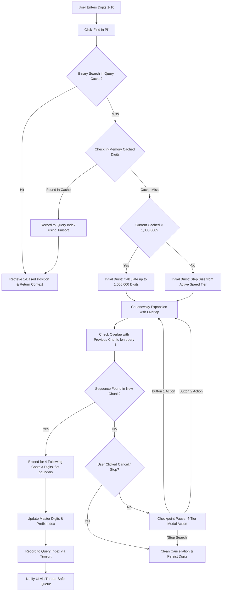

# PiPhone: Project Definition & Technical Architecture Specification

## 1. Executive Summary & Vision

**PiPhone** is an interactive desktop application combining a tactile, dark-mode telephone dialer interface (`customtkinter`) with an arbitrary-precision $\pi$ search engine. The premise is rooted in mathematical normality: in an infinite, non-repeating, normal decimal expansion of $\pi$, every finite sequence of digits—including any 1- to 10-digit telephone number—is guaranteed to appear.

PiPhone allows users to dial or enter any phone number or digit sequence up to 10 digits and locate its exact 1-based decimal position within $\pi$. To deliver a responsive user experience across deep decimal expansions, PiPhone employs:
* A fast-converging **Chudnovsky algorithm** calculation engine implemented in `mpmath` (with optional `gmpy2` hardware acceleration).
* A persistent disk cache of generated digits (`data/pi_digits.txt`).
* A two-tiered sorted index leveraging Python's **Timsort** and **Binary Search** (`bisect`) for sub-millisecond repeated queries.
* Asynchronous chunked calculation in background worker threads with boundary overlap checking and cooperative thread cancellation.

---

## 2. User Interface & Experience Architecture

The UI is built with `customtkinter` configured in dark mode (`"Dark"`, theme `"blue"`), presenting a modern, distraction-free telephony interface.

```
+-------------------------------------------------------------+
| PIPHONE                                           * Ready   |
+-------------------------------------------------------------+
|  [ Pi Dialer ]    [ Search History ]                        |
| +---------------------------------------------------------+ |
| |                    [  8675309  ]                        | |
| |                                                         | |
| |     [  1  ]             [  2  ]             [  3  ]     | |
| |     [  4  ]             [  5  ]             [  6  ]     | |
| |     [  7  ]             [  8  ]             [  9  ]     | |
| |     [ CLR ]             [  0  ]             [  <- ]     | |
| |                                                         | |
| |            [       Find in Pi       ]                   | |
| |                                                         | |
| |   Result:                                               | |
| |            9245   8675309   1239                        | |
| |   Found at decimal digit #9,213,421                     | |
| |   Source: Calculated 200,000 new digits (1.2s)          | |
| +---------------------------------------------------------+ |
+-------------------------------------------------------------+
```

### 2.1 Two-Tab Layout
The former three-tab layout (`Dialer`, `Contacts`, `History`) is replaced by a focused two-tab interface:
1. **Pi Dialer**: The core interactive keypad, input display, search controls, and visual match context display.
2. **Search History**: A searchable, scrollable log of all queries performed in the current session and historical sessions.
*(The legacy `Contacts` tab is completely removed).*

### 2.2 Input Field & Digit Sanitization
* **Allowed Characters**: Numeric digits `0-9` only.
* **Length Bounds**: 1 digit minimum, **10 digits maximum** (standard North American / international phone number without country code).
* **11th Digit Enforcement**:
  * Keypad clicks are blocked when `len(current_input) >= 10`.
  * Keyboard typing and clipboard pasting events are intercepted via a validation callback (`validate="key"`). Any insertion causing `len > 10` or containing non-digits (`[^0-9]`) is rejected immediately.
* **Visual Styling**: Centered `CTkEntry` with large, prominent typography (`24pt`, bold) and subtle placeholder (`"Enter 1-10 digits..."`).

### 2.3 Keypad Layout & Custom Action Keys
The dial pad follows the standard 3x4 layout with repurposed telephony control keys:
* Row 1: `[1]`, `[2]`, `[3]`
* Row 2: `[4]`, `[5]`, `[6]`
* Row 3: `[7]`, `[8]`, `[9]`
* Row 4:
  * Bottom-Left: **Clear (`CLR`)** — Replaces `*`. Instantly clears the input field and resets match displays.
  * Bottom-Center: `[0]` — Standard digit.
  * Bottom-Right: **Backspace (`<-` / `DEL`)** — Replaces `#`. Deletes the trailing character.

### 2.4 Primary Action Button & State Transformation
* **Default State**: Prominent green button labeled **Find in Pi** (`fg_color="#2E7D32"`, `hover_color="#1B5E20"`).
* **Disabled State**: When the input field is empty, the button is disabled (`state="disabled"`).
* **Active Calculating State**: When a search triggers background $\pi$ expansion, the button dynamically transforms into a bold red **Cancel** button (`fg_color="#C62828"`, `hover_color="#B71C1C"`, text `"Cancel Search"`).
  * Clicking **Cancel** signals the background calculation thread via a `threading.Event`, safely halts chunk generation, preserves all computed digits to disk, and resets the UI state.

### 2.5 Visual Result Display & Contextual Ellipses
When a match is found, the target sequence is displayed flanked by its surrounding decimal context with clear font size hierarchy and contextual ellipses:

```
[ ...Preceding 4 Digits ]   [ TARGET MATCHED DIGITS ]   [ Following 4 Digits... ]
      (14pt, Muted)               (28pt, Bold Accent)          (14pt, Muted)
```

#### Exact Start-of-Pi Rule & Ellipsis Formatting
* Position `1` is defined as the **first digit after the decimal point** (`1` in `3.1415926535...`).
* **Standard Case (Position >= 5)**: Prepend leading `...` to the 4 preceding digits and append trailing `...` to the 4 following digits:
  * **Position 5+** (`9265`): Preceding = `...1415`, Target = `9265`, Following = `3589...`
* **Start-of-Pi Edge Case (Positions 1 through 4)**: When a match occurs within the first 4 decimal digits, the integer part `"3."` is included in the preceding context. Crucially, the **leading `...` is omitted** before `"3."` because nothing precedes the decimal point in $\pi$:
  * **Position 1** (`1415`): Preceding = `3.`, Target = `1415`, Following = `9265...`
  * **Position 2** (`4159`): Preceding = `3.1`, Target = `4159`, Following = `2653...`
  * **Position 3** (`1592`): Preceding = `3.14`, Target = `1592`, Following = `6535...`
  * **Position 4** (`5926`): Preceding = `3.141`, Target = `5926`, Following = `5358...`

### 2.6 Live Telemetry & Status Panel
* **Searching State**: Live real-time counter updated continuously:
  `"Calculating Pi... 1,400,000 digits searched (2.3s elapsed)"`
* **Found State**:
  * Position: `"Found at decimal digit #14,892"`
  * Latency & Source:
    * Cache Hit: `"Source: Sorted Index Cache (0.2ms)"`
    * Calculated: `"Source: Calculated 100,000 new digits (1.4s)"`
* **Cancelled State**: `"Search cancelled by user."`

### 2.7 Search History Tab & Total Cached Digits Banner
* **Total Digits Telemetry Banner**: Prominent cyan card (`#00E5FF`) at the top of the history tab displaying:
  **`Total Pi Digits Cached: X,XXX,XXX`**
  Automatically updates when new digits are calculated or when switching to the History tab.
* **Scrollable History Feed**: A scrollable table (`CTkScrollableFrame`) displaying historical searches:
  * Columns: Searched Digits | Found Position | Context Snippet | Latency | Source | Timestamp.
  * Storage: Persisted on disk at `data/search_history.json`.
  * Actions: One-click "View" button to reload any past match back into the main dialer display.

### 2.8 Keyboard & Numpad Input Bindings
Full keyboard navigation is enabled whenever the **Pi Dialer** tab is active:
* **Numeric Keys `0`–`9` & Numpad**: Appends digit to the dialer input (enforces 10-digit limit and prevents double-entry when `CTkEntry` has focus).
* **`Return` / `KP_Enter`**: Initiates **Find in Pi** (if input length is 1–10 digits and not searching).
* **`BackSpace`**: Deletes trailing digit (`⌫`).
* **`Escape` / `Delete`**: Clears entire input field (`CLR`).

### 2.9 Interactive Checkpoint Pause Modal & 5-Tier Escalating Schedule (v2.0)
When a search misses the existing cache and calculates new digits:
* **1,000,000-Digit Initial Burst**: If `current_total < 1,000,000` digits, the engine automatically calculates up to 1,000,000 digits in the initial burst before triggering the first checkpoint modal. If `current_total >= 1,000,000`, the initial burst uses Option 1's step size from the active speed tier.
* **$T_{\text{min\_step}}$ Golden Rule**: Evaluates $T_{\text{min\_step}} = \text{estimate\_chunk\_time}(\text{current\_total}, 2\_000\_000)$ and ensures that no time-budget button ever offers a duration shorter than $1.25 \times T_{\text{min\_step}}$.
* **Cold-Start CPU Calibration**: If running from a deep cache without live calculations in the current session, the engine runs an in-memory 0.1-second micro-benchmark (computing 500,000 digits) to calibrate $N_{\text{last}}$ and $T_{\text{last}}$ directly to the host CPU before computing estimates.
* **5-Tier Escalating Schedule**:
  * **Tier 1 ($T_{\text{min\_step}} < 15.0\text{s}$)**:
    * Button 1: **`Continue (+1,000,000 Digits) [~X.Xs]`**
    * Button 2: **`Search for 30 Seconds`**
  * **Tier 2 ($15.0\text{s} \le T_{\text{min\_step}} < 24.0\text{s}$)**:
    * Button 1: **`Continue (+1,000,000 Digits) [~XXs]`**
    * Button 2: **`Search for 60 Seconds`**
  * **Tier 3 ($24.0\text{s} \le T_{\text{min\_step}} < 48.0\text{s}$)**:
    * *`+1,000,000` retired*
    * Button 1: **`Search for 1 Minute`**
    * Button 2: **`Search for 2 Minutes`**
  * **Tier 4 ($48.0\text{s} \le T_{\text{min\_step}} \le 90.0\text{s}$)**:
    * Button 1: **`Search for 2 Minutes`**
    * Button 2: **`Search for 5 Minutes`**
  * **Tier 5 ($T_{\text{min\_step}} > 90.0\text{s}$ — Deep Pi / 100M+ Mode)**:
    * Modal Warning Note: *"At {current_total:,} digits, computing the next block of Pi requires ~{T_{\text{min\_step}} / 60:.1f} minutes."*
    * Button 1: **`Calculate Next Block (~X Mins)`** (single $+2,000,000$ digit chunk pass)
    * Button 2: **`Search for X Minutes`**
* **Wall-Clock Time-Budget Burst Loop**: When a time-budget button is selected (e.g. 30s, 60s, 120s, 300s):
  * Runs a true wall-clock timer loop (`deadline = start + target_seconds`) continuously expanding and searching $\pi$ in calibrated multi-million digit chunks.
  * Emits live progress telemetry: `"Running {budget}s Burst... [{elapsed:.1f}s / {budget}s] — {digits:,} digits searched"`.
  * If the match is found at any point during the burst, immediately terminates the loop and displays the result.
  * If the budget expires without finding the sequence, pauses and presents the Checkpoint Modal again with freshly calibrated speed tiers.
* **Modal Dialog (`CTkToplevel`)**: Centered over the main window, blocking main window interactions (`grab_set()`).
* **Stop Search**: Halts search, persists all computed digits and index entries to disk, updates the History tab banner, and resets UI state.

### 2.10 Bundled 100,000,000-Digit Compressed Seed Pack (v2.0)
* **Pre-calculated Ground Truth**: The application bundles a 100,000,000 decimal digit seed pack of $\pi$ (excluding `"3."`), verified against ground-truth mathematical constants and landmark sequence positions.
* **Compact Repository Storage**: Compressed with `zstandard` (level 19) into `seed/pi_100m.zst` at **40.56 MB**, fitting under GitHub's 50 MB file limit.
* **Seamless First-Launch Decompression**: On initial startup or first launch of `PiPhone.exe`, if `data/pi_digits.txt` has fewer than 100,000,000 digits, the engine automatically extracts the seed into the local cache.
* **Instantaneous Searches**: 100% of 1-to-7 digit queries and ~63% of 8-digit queries resolve instantaneously in $< 20\text{ms}$ on first launch without requiring background CPU computation.

---

## 3. Algorithmic & Storage Architecture



### 3.1 Hardware-Accelerated Pi Calculation & Time-Budget Engine (`gmpy2` + `mpmath`)
The calculation engine uses the Ramanujan-Chudnovsky hypergeometric series:

$$\frac{1}{\pi} = 12 \sum_{k=0}^{\infty} \frac{(-1)^k (6k)! (545140134k + 13591409)}{(3k)! (k!)^3 (640320)^{3k + 3/2}}$$

* **Hardware Acceleration via `gmpy2`**:
  * Leverages compiled C GNU Multiple Precision Arithmetic (GMP/MPFR/MPC) backend via `gmpy2`.
  * `mpmath` automatically detects and binds `mpmath.libmp.BACKEND == 'gmpy'`, delivering **10x–15x higher throughput** than pure Python.
  * Graceful fallback to pure Python `BACKEND == 'python'` if `gmpy2` is not present.
* **Empirical Time Estimation & Inverse Time-Budget Engine**:
  * Forward Scaling Law (1.65 exponent to model base-10 conversion overhead at 20M–50M+ digits):
    $$T_{\text{est}} = T_{\text{last}} \times \left(\frac{\text{current\_total} + \text{chunk\_delta}}{N_{\text{last}}}\right)^{1.65}$$
  * Inverse Scaling Law (`estimate_digits_for_time`):
    $$N_{\text{target}} = \text{int}\left(N_{\text{last}} \times \left(\frac{T_{\text{budget}}}{T_{\text{last}}}\right)^{1 / 1.65}\right)$$
    $$\Delta N = \max\left(100\_000, \text{round}\left(\frac{N_{\text{target}} - \text{current\_total}}{100\_000}\right) \times 100\_000\right)$$
  * Step caps enforce $\Delta N \le 10,000,000$ digits for $\le 30\text{s}$ bursts and $\Delta N \le 20,000,000$ digits for $\le 60\text{s}$ bursts, preventing runaway jumps from fast benchmarks.

### 3.2 Persistent Raw Stream (`data/pi_digits.txt`)
* **Format**: Plain ASCII text file containing contiguous decimal digits of $\pi$ directly following `3.`.
  * Index offset 0 in the file corresponds to 1-based decimal digit position 1 (`1` in `14159...`).
* **Chunked Appending**: Newly computed digits are persisted and flushed upon completion of each step.
* **Zero Corruption Guarantee**: On application startup, the file length determines the starting baseline precision.

### 3.3 Boundary Stitch Logic, Safety Lookahead & Prefix Indexing
1. **Boundary Overlap Guarantee**:
   * Substring search scans starting at 0-based offset `max(0, current_len - (len(query) - 1))`.
   * Global 1-based position is calculated as `overlap_start + window_idx + 1`. Any sequence straddling chunk boundaries is guaranteed to be detected on its first occurrence.
2. **End-of-Chunk Lookahead Safety**:
   * If a match occurs on the terminal digits of a chunk such that fewer than 4 following digits exist (`global_pos - 1 + len(query) + 4 > len(digits)`), the engine automatically triggers `_expand_to_length(needed_len)` so all 4 context digits are immediately available for display.
3. **Incremental 4-Digit Prefix Indexing**:
   * Upon each expansion from `old_len` to `len(digits)`, the engine scans `max(0, old_len - 3)` through `len(digits) - 3` to index boundary-straddling 4-digit prefixes without full table recomputation.
   * Maintains sorted order via Timsort.

---

## 4. Concurrency & Thread-Safety Model

```
+------------------+         Queue.Queue          +-----------------------+
|  Tkinter Main UI | <--------------------------  | Calculation Thread    |
|  (60 FPS Loop)   |                              | (Chudnovsky Worker)   |
|                  |  --- threading.Event ---->   |                       |
+------------------+     (cancel_requested)       +-----------------------+
```

1. **Non-Blocking GUI**: All heavy arithmetic and disk searches run exclusively on background threads. The main Tkinter event loop remains responsive at 60 FPS.
2. **Thread-Safe Telemetry**: The background worker places periodic progress messages `(digits_searched, elapsed_seconds)` into a `queue.Queue`. The UI polls this queue every 50ms using `self.after(50, self._poll_search_queue)`.
3. **Cooperative Cancellation**: When the user clicks **Cancel**, a `threading.Event` (`cancel_event.set()`) is flagged. The Chudnovsky chunk loop checks `cancel_event.is_set()` before starting each term iteration and chunk write. On abort, it writes the completed digits and terminates gracefully.

---

## 5. Directory Structure & File Layout

```
PiPhone/
|-- data/
|   |-- pi_digits.txt          # Raw ASCII stream of calculated pi digits (excluding "3.")
|   |-- pi_index.json           # Persisted sorted index (queries + prefix offsets)
|   +-- search_history.json     # Search history log
|-- tests/
|   |-- __init__.py
|   +-- test_pi_engine.py       # Full pytest suite covering TC-01 through TC-07
|-- piphone.py                  # Main CustomTkinter UI application
|-- pi_engine.py                # Core calculation, indexing, and search engine
|-- PROJECT_DEFINITION.md       # Complete system architecture and spec
|-- TEST_PLAN.md                # Comprehensive test cases and verification matrix
|-- FEATURE_BACKLOG.md          # Future roadmap and prioritized backlog
|-- requirements.txt            # Package dependencies
+-- requirements.md             # Dependency documentation
```

